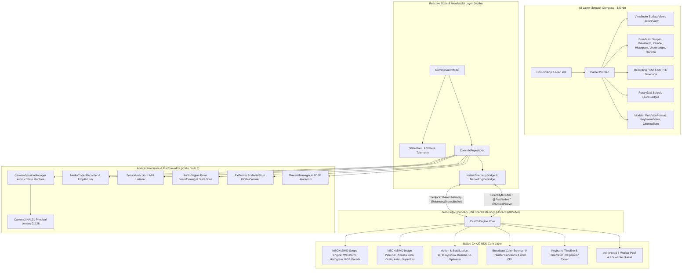

# COMMIX PRO CAMERA: NATIVE ANDROID (KOTLIN + JETPACK COMPOSE + C++20 NDK) ARCHITECTURE SPECIFICATION

> **Document Version:** 1.0.0  
> **Platform Target:** Native Android (Min SDK: 28, Target SDK: 35/36)  
> **Primary ABI:** `arm64-v8a` with ARM64 NEON SIMD  
> **Design Philosophy:** Zero-Jank 120Hz Viewfinder, Bare-Metal Compute in C++20, Zero-Copy JNI Boundaries, Zero Allocation on Hot Paths  

---

## 1. Executive System Architecture

Commix Pro Camera is rewritten from Flutter/Dart into an ultra-high performance, studio-grade cinematography and computational photography camera application targeting Android devices.

The architecture decouples the system into three distinct runtime layers:
1. **Bare-Metal Compute Layer (C++20 / Android NDK):**
   Heavy algorithms, raw buffer manipulation, mathematical transformations, lock-free queues, 8-worker thread pool, and real-time broadcast scopes.
2. **Hardware Orchestration & Platform Layer (Kotlin 2.x):**
   Direct Camera2 HAL3 sessions, high-speed MediaCodec surface video encoding, multi-mic beamforming, sensor listeners, and MediaStore I/O.
3. **Reactive UI & Viewfinder Layer (Jetpack Compose):**
   Hardware-accelerated rendering, declarative UI with Strong Skipping mode, custom `Canvas` scope drawing, tactile dials, and Apple/Cupertino cinema aesthetic.



---

## 2. JNI Shared Memory Layout & Zero-Copy Protocol

### 2.1 Sequence Lock (Seqlock) Telemetry Buffer
To pass 60–120Hz telemetry (audio levels, IMU orientation, histograms, waveform columns, RGB parade, vectorscope, and spot IRE) from native worker threads to the UI without allocating objects or locking mutexes, a shared memory structure is synchronized via an atomic sequence counter.

#### Seqlock Invariants:
1. `seq_begin` is incremented to an **odd** integer before writing begins (`std::memory_order_release`).
2. Data fields are updated in-place.
3. `seq_end` is updated to `seq_begin + 1` (**even**) after all data fields are finalized (`std::memory_order_release`).
4. Readers read `seq_begin`. If odd, a write is in progress $\rightarrow$ reader discards frame or uses previous cache.
5. Reader copies primitives into local stack.
6. Reader checks `seq_end == seq_begin`. If mismatched, write occurred during read $\rightarrow$ reader discards frame.

```cpp
#pragma once
#include <cstdint>

#define COMMIX_HIST_BINS 256
#define COMMIX_WAVE_COLS 64
#define COMMIX_PARADE_N 64
#define COMMIX_VSCOPE_MAX_SAMPLES 256

#pragma pack(push, 4)
struct TelemetrySharedBuffer {
    uint32_t seq_begin;
    uint32_t has_scopes;

    // Audio VU Meters
    float audio_norm;
    float audio_db;
    float audio_left_db;
    float audio_right_db;

    // Motion & Orientation (IMU)
    float gyro_pitch;
    float gyro_roll;
    float gyro_yaw;

    // Lens & Focus
    float af_distance;
    int32_t af_state;

    // Histograms
    int32_t luma_bins[COMMIX_HIST_BINS];
    int32_t r_bins[COMMIX_HIST_BINS];
    int32_t g_bins[COMMIX_HIST_BINS];
    int32_t b_bins[COMMIX_HIST_BINS];

    // Waveform (Luma IRE 0..100)
    float wave_cols_avg[COMMIX_WAVE_COLS];
    float wave_cols_min[COMMIX_WAVE_COLS];
    float wave_cols_max[COMMIX_WAVE_COLS];

    // RGB Parade
    float parade_r[COMMIX_PARADE_N];
    float parade_g[COMMIX_PARADE_N];
    float parade_b[COMMIX_PARADE_N];

    // Vectorscope (Interleaved X, Y pairs in -1.0 .. 1.0)
    float vscope_samples[COMMIX_VSCOPE_MAX_SAMPLES * 2];
    int32_t vscope_count;

    // Center Spot Meter & Chroma Moments
    float spot_ire;
    float mean_u;
    float mean_v;
    float hi_clip_pct;
    float lo_clip_pct;

    uint32_t seq_end;
};
#pragma pack(pop)
```

### 2.2 DirectByteBuffer & JNI Method Table
All JNI interactions use explicit method registration in `JNI_OnLoad` via `RegisterNatives`. No dynamic lookup (`Java_com_...`) is used.
Methods processing buffer addresses are annotated with `@FastNative` or `@CriticalNative`.

```cpp
static const JNINativeMethod g_telemetry_methods[] = {
    {"nativeGetBufferPointer", "()J", (void*)native_get_buffer_pointer},
    {"nativeWriteAudio", "(FFFF)V", (void*)native_write_audio},
    {"nativeWriteImu", "(FFF)V", (void*)native_write_imu},
    {"nativeComputeScopesDirect", "(Ljava/nio/ByteBuffer;Ljava/nio/ByteBuffer;Ljava/nio/ByteBuffer;IIIIII)V", (void*)native_compute_scopes_direct}
};

static const JNINativeMethod g_engine_methods[] = {
    {"nativeInitEngine", "()Z", (void*)native_init_engine},
    {"nativeDestroyEngine", "()V", (void*)native_destroy_engine},
    {"nativeProcessZero", "(Ljava/nio/ByteBuffer;IIILjava/lang/String;Ljava/lang/String;F)Z", (void*)native_process_zero},
    {"nativeStackAstroFrames", "([Ljava/nio/ByteBuffer;IILjava/nio/ByteBuffer;Z)Z", (void*)native_stack_astro_frames},
    {"nativeComputeL1Stabilization", "([F[FII[F)V", (void*)native_compute_l1_stabilization},
    {"nativeApplyCdl", "(Ljava/nio/ByteBuffer;IIFFFFF)V", (void*)native_apply_cdl}
};
```

---

## 3. C++20 Core Module Breakdown

### 3.1 `scopes_engine` (ARM64 NEON Vectorized Scopes)
- **Input:** Direct Y, U, V byte buffers from Camera2 YUV_420_888 ImageReader.
- **NEON Optimizations:**
  - 8-pixel parallel integer color conversion using `vld1_u8`, `vmull_u8`, `vaddw_u16`.
  - Parallel column-reduction for 64-column Waveform using SIMD min/max (`vmin_u8`, `vmax_u8`).
  - Zero heap allocation: all histograms and parade buffers reside in `TelemetrySharedBuffer`.

### 3.2 `image_pipeline` (Process Zero & Analog Grain Simulation)
- **Tone Mapping:** Precomputed 256-entry S-curve lookups (`film_print`, `cine_d`, `neutral`).
- **Silver Halide Film Grain Simulation:**
  - Evaluates pixel luma: $Y = 0.2126R + 0.7152G + 0.0722B$.
  - Parabolic midtone mask: $\text{Mask} = 4.0 \cdot Y \cdot (1.0 - Y)$.
  - Multi-threaded SIMD PRNG (Xorshift128+) adding organic analog silver grain to midtones while leaving pure blacks and highlights pristine.
  - Slices image horizontally across the 8-worker thread pool.

### 3.3 `computational_photo` (28+ Algorithmic Photography Engines)
1. **Hyperfocal Engine:** Hyperfocal and depth of field calculations based on circle of confusion $H = \frac{f^2}{N \cdot c} + f$.
2. **Astrophotography Stacker:** Bright star centroid extraction, affine translation/rotation alignment, and median pixel stacking.
3. **Long Exposure Accumulator:** Exponential running average ($A_t = (1-\alpha)A_{t-1} + \alpha I_t$) for silky water, and max-intensity accumulator for light trails.
4. **Action Pan Engine:** 1D directional motion blur convolution aligned with IMU angular velocity vector.
5. **Multi-Exposure Compositor:** Additive, average, lighten, and darken blend modes on float buffers.
6. **Cinematic Bokeh Engine:** Depth map guided disk convolution blur.
7. **Super-Resolution Zoom:** Multi-frame subpixel phase shift registration with Lanczos reconstruction kernel.
8. **Focus Stacking:** High-frequency Sobel variance map weighting.
9. **Perspective Rectification:** 4-point planar homography transformation.
10. **Defocus Autofocus (DFD):** Circle of confusion diameter estimation.
11. **Chromatic Constancy:** Gray World and Minkowski norm white balance.
12. **Lens Aberration Correction:** Fourth-order polynomial radial distortion correction ($r' = r(1 + k_1 r^2 + k_2 r^4)$).
13. **Rolling Shutter Rectification:** Gyro angular velocity line-by-line shear compensation.
14. **Underwater Radiometric Restoration:** Wavelength-dependent red attenuation recovery.
15. **Document Dewarping:** Cylindrical coordinate unrolling.

### 3.4 `stabilization_engine` (Motion & Gyroflow Logging)
- **1kHz IMU Ring Buffer:** Circular memory buffer storing `ImuSample(timestampNs, gx, gy, gz, ax, ay, az)` directly from Android sensor events.
- **Gyroflow v1.3 `.gcsv` Exporter:** Fast zero-copy serialization of IMU samples into Gyroflow CSV file on recording stop.
- **Virtual Gimbal Kalman Filter:** 6-DOF state prediction and measurement update for orientation smoothing.
- **L1 Camera Path Optimizer:** Tridiagonal matrix solver for L1 trend filtering minimizing second-order differences:
  $$\min_p \frac{1}{2} \|p - c\|_2^2 + \lambda \|D^2 p\|_1$$
- **5 Stabilization Paradigms:** Subspace Warp, Neural Flow, HyperSmooth, Action Mode, and Virtual Gimbal.

### 3.5 `color_science` (Broadcast Transfer Curves & ASC CDL v1.2)
- Mathematical transfer functions for:
  - ARRI LogC3 & LogC4
  - Sony S-Log3
  - Canon C-Log2
  - RED Log3G10
  - Apple Log
  - ARIB STD-B67 HLG
  - SMPTE ST 2084 PQ (HDR10)
  - Rec.709
- ASC CDL v1.2 grading formula:
  $$C_{\text{out}} = \left( C_{\text{in}} \times \text{Slope} + \text{Offset} \right)^{\text{Power}}$$
  followed by Rec.709 luma saturation adjustment.

### 3.6 `keyframe_engine` & `best_shot_engine`
- **Keyframe Engine:** Evaluates multi-track parameter splines (zoom, ISO, shutter, EV, WB, focus) at 60Hz. Supports linear, easeIn, easeOut, easeInOut, and hold curves.
- **Best Shot Engine:** Maintains a rolling window of gyro angular velocities, calculates frame stillness index, dynamic range, and exposure score, and fires the "SHOOT NOW" cue.

### 3.7 `thread_pool`
- Persistent pool of `std::jthread` workers (8 threads) attached to a lock-free work-stealing queue.
- Replaces dynamic thread creation on capture and compute hot paths.

---

## 4. Kotlin Infrastructure & Hardware Subsystems

### 4.1 `CameraSessionManager` (Atomic Finite State Machine)
Enforces verified transitions using `AtomicReference<CameraState>`:
- `CLOSED -> OPENING -> OPENED -> CONFIGURING -> ACTIVE_PREVIEW`
- `ACTIVE_PREVIEW -> CAPTURING_STILL -> ACTIVE_PREVIEW`
- `ACTIVE_PREVIEW -> RECORDING_VIDEO -> ACTIVE_PREVIEW`
- `ACTIVE_PREVIEW -> CONFIGURING -> ACTIVE_PREVIEW`
- `* -> CLOSING -> CLOSED`
- `* -> ERROR -> CLOSING -> CLOSED`

### 4.2 `LensProbeService`
Probes camera IDs `0` through `128` to detect hidden auxiliary lenses on Xiaomi, Samsung, Realme, and OnePlus devices. Categorizes sensors into:
- `FRONT`
- `WIDE` (23mm–35mm equivalent)
- `ULTRAWIDE` (<22mm equivalent or ID 21)
- `TELEPHOTO` (>35mm equivalent or ID 3/4)
- `MACRO` (minFocus >= 15 diopters or ID 22)
- `DEPTH` (<2MP fixed focus or ID 20)

### 4.3 `CaptureRequestFactory`
Builds Camera2 requests without reflection:
- Manual ISO (`SENSOR_SENSITIVITY`) & Exposure time (`SENSOR_EXPOSURE_TIME`).
- Auto-Exposure Compensation (`CONTROL_AE_EXPOSURE_COMPENSATION`).
- Manual Focus Diopters (`LENS_FOCUS_DISTANCE`).
- Manual White Balance (`COLOR_CORRECTION_GAINS` with `RggbChannelVector`).
- Optical/Digital Zoom (`CONTROL_ZOOM_RATIO` on API 30+, fallback to `SCALER_CROP_REGION`).
- OIS & EIS modes (`LENS_OPTICAL_STABILIZATION_MODE`, `CONTROL_VIDEO_STABILIZATION_MODE`).

### 4.4 `DeviceQuirksManager`
- Detects MediaTek Helio G90T / MT6785 (`begonia`), Qualcomm Snapdragon, Samsung Exynos, and Google Tensor.
- Enforces HeifWriter byte-size threshold ($\ge \text{pixels} \times 0.04$ bytes), falling back to 95% JPEG if undersized.
- Restricts 4K video recording to 30.0 fps on hardware prone to encoder crashes.
- Disables preview Night Scene mode to prevent black viewfinder bug on MTK HAL.

### 4.5 `MediaCodecRecorder` & `Fmp4Muxer`
- Direct Surface input encoding via MediaCodec (H.264 / HEVC).
- Fragmented MP4 (`Fmp4Muxer`) with 1-second GOPs, guaranteeing valid video playback even upon sudden process termination.

### 4.6 `AudioEngine`
- Multi-microphone direction routing (`setPreferredMicrophoneDirection` on API 29+).
- Polar field dimension zooming ($0.0$ omni to $1.0$ shotgun).
- 160ms 1kHz sync beep emission using Android `ToneGenerator`.

### 4.7 `SensorHub`, `ThermalManager` & `ExifWriter`
- High-rate IMU listener directly streaming samples into the C++ `TelemetrySharedBuffer`.
- `ThermalManager` with ADPF headroom queries.
- `ExifWriter` injecting camera specifications, optical parameters, GPS coordinates, and technical JSON clapperboard slate metadata into output files.

---

## 5. Jetpack Compose UI Architecture & Navigation

### 5.1 Design Language
Pure Cupertino/Apple Pro dark cinema aesthetic:
- Deep black background (`#000000`).
- Apple Camera yellow accents (`#FFCC00`).
- Studio recording red tally (`#FF3B30`).
- Subtle grey borders and glassmorphic cards (`#1C1C1E`).
- Monospaced numeric font for timecodes, ISO, and shutter speed.

### 5.2 Navigation Graph & Screen Layout
Single Activity architecture with Compose Navigation:
```
NavHost
 └── CameraScreen (Root Viewport)
      ├── ViewfinderSurface (SurfaceView / TextureView)
      ├── TopBar (Flash, HDR, RAW, Format Pill, Battery, Storage, Thermal)
      ├── ViewportOverlays (Waveform, Histogram, RGB Parade, Vectorscope, Horizon, Grid, Reticle)
      ├── RotaryDialBar (Tactile thumbwheel for ISO, Shutter, Focus, EV, WB)
      ├── ModeCarousel (NIGHT, SLOW-MO, VIDEO, CINE, PHOTO, PRO, TIME-LAPSE, AUTOMATION)
      ├── BottomControls (Gallery Thumbnail, Shutter Trigger, Camera Switcher)
      └── Modals (Launched via ModalBottomSheet / Dialog):
           ├── ProVideoFormatModal (Magnetic FPS, Resolutions, Bitrates)
           ├── CinemaSlateSheet (Fullscreen Clapperboard & Sync Tone)
           ├── KeyframeEditorModal (Multi-Track Spline Editor)
           ├── ProSettingsSheet (Comprehensive Tabbed Settings)
           └── ProcessingQueueSheet (Background Computational Jobs)
```

### 5.3 Compose Optimization & Recomposition Invariants
1. Strong Skipping Mode enabled.
2. All UI state models annotated with `@Immutable` or `@Stable`.
3. High-frequency telemetry (IMU pitch/roll, audio dB levels) observed via `derivedStateOf` or direct `Canvas` drawing without triggering parent Composable recomposition.
4. `LazyColumn` / `LazyRow` components explicitly provide `key` and `contentType`.
5. Compose metrics reporting enabled (`-Pandroidx.compose.compiler.reportsDestination=...`).

---

## 6. Build System & Optimization Invariants

1. **Gradle Kotlin DSL:** Modern Gradle 8.7+ with Android Gradle Plugin 8.7+ and Kotlin 2.1+.
2. **R8 Full Mode:** `android.enableR8.fullMode=true` with strict ProGuard consumer rules preserving JNI entry points and stripping unused bytecode.
3. **C++20 Compilation Flags:**
   ```cmake
   -O3 -flto -ffunction-sections -fdata-sections -Wl,--gc-sections
   -fno-exceptions -fno-rtti -march=armv8-a+simd+crypto
   -Wl,-z,max-page-size=16384 -Wl,-z,common-page-size=16384
   ```
4. **16KB Page-Size Alignment:** Enforced linker flags guaranteeing compatibility with modern Android 15+ 16KB kernel page sizes.
5. **Single ABI Distribution:** Restricting `abiFilters` to `arm64-v8a` yielding the smallest footprint and peak 64-bit performance.
